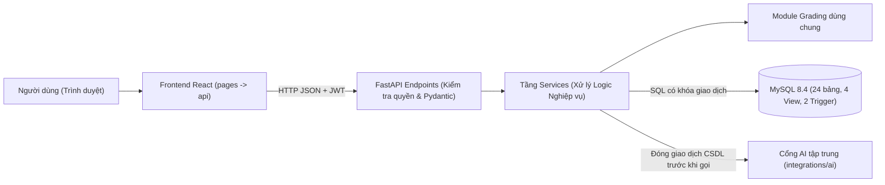

# 05. Sổ tay Đọc hiểu Mã nguồn & Hỏi – Đáp Bảo vệ Luận văn Tốt nghiệp

*(Tài liệu này được biên soạn riêng để bạn nắm trọn kiến trúc hệ thống, biết chính xác **file nào làm gì, hàm nào xử lý nghiệp vụ, dữ liệu đi từ giao diện xuống CSDL như thế nào** và tự tin trả lời mọi câu hỏi vấn đáp của Hội đồng / Thầy hướng dẫn).*

---

## Phần I. Trả lời 5 câu hỏi tổng quan của Thầy hướng dẫn

### 1. Hệ thống gồm những thành phần nào?
Hệ thống **Xianglingo** được xây dựng theo kiến trúc **3 tầng tách biệt (3-Tier Architecture)** kết hợp cổng dịch vụ AI bên ngoài:
1. **Tầng Giao diện (Frontend — Single Page Application)**:
   - Công nghệ: **React 19**, **React Router 7**, **Vite 8**, CSS thuần theo biến thiết kế (`tokens.css`).
   - Nhiệm vụ: Hiển thị giao diện cho 4 nhóm đối tượng (*Khách, Học viên, Giảng viên, Quản trị viên*), quản lý trạng thái màn hình, gửi HTTP JSON kèm JWT Bearer Token lên Backend qua [httpClient.js](file:///d:/HSK_AI/frontend/src/shared/api/httpClient.js).
2. **Tầng Xử lý Nghiệp vụ & API (Backend — Modular Monolith)**:
   - Công nghệ: **Python 3**, **FastAPI**, **Pydantic v2** (kiểm tra dữ liệu vào/ra), **SQLAlchemy Core** + **PyMySQL**.
   - Nhiệm vụ: Xác thực phân quyền JWT, thực thi **100% logic quyết định nghiệp vụ** (chấm điểm khách quan, rẽ nhánh thích ứng 8 câu, trừ/cộng năng lượng, tính điểm KN, kiểm tra mở khóa 3 tầng, kiểm soát phiên bản câu hỏi) và điều phối gọi AI an toàn qua cổng tập trung [client.py](file:///d:/HSK_AI/backend/app/integrations/ai/client.py).
3. **Tầng Lưu trữ (Database & File Storage)**:
   - **MySQL 8.4** (`xianglingo`): **24 bảng chuẩn 3NF + 4 View + 2 Trigger**, cố định múi giờ `+07:00` ngay khi mở kết nối tại [session.py](file:///d:/HSK_AI/backend/app/database/session.py).
   - **Lưu trữ tệp hai vùng**: `backend/uploads/` (phục vụ âm thanh/hình ảnh câu hỏi qua `/media`) và `backend/private_uploads/` (lưu học liệu PDF riêng tư, bắt buộc qua API kiểm tra đăng nhập mới mở được tệp).

---

### 2. Mã nguồn của dự án được tổ chức như thế nào? Logic nghiệp vụ nằm ở đâu?
Dự án tổ chức theo **Phân hệ theo miền nghiệp vụ (Feature / Domain-based Modular Structure)** kết hợp **Phân lớp bên trong từng phân hệ**:

- **Ở Frontend (`frontend/src/`)**:
  - `app/App.jsx`: Bản đồ toàn bộ đường dẫn URL của trang web và kiểm tra quyền bằng `routes/RequireRole.jsx`.
  - `shared/`: Những thứ dùng chung cho toàn web (`api/httpClient.js`, `components/HanziText.jsx`, `components/LessonParts.jsx`, `hooks/useTheme.js`, `utils/format.js`, `utils/rank.js`).
  - `features/<ten_chuc_nang>/`: Mỗi chức năng đều chia đúng 5 ngăn cố định:
    - `pages/`: Màn hình giao diện người dùng nhìn thấy.
    - `components/`: Các mảnh giao diện con tách nhỏ để dễ đọc.
    - `hooks/`: React Hooks quản lý dữ liệu riêng.
    - `api/`: Các hàm gọi xuống Backend (`http.get`, `http.post`...).
    - `utils/` & `styles/`: Hàm tính phụ trợ và CSS.

- **Ở Backend (`backend/app/`)**:
  - `api/router.py`: Nơi duy nhất gắn 19 router con vào tiền tố `/api`.
  - `security/`: Giải mã JWT (`current_user.py`) và các chốt chặn vai trò (`require_student.py`, `require_lecturer.py`, `require_admin.py`).
  - `integrations/ai/`: Cổng duy nhất nói chuyện với OpenAI/LLM (`config.py`, `client.py`, `prompts.py`).
  - `modules/grading/`: Bộ chấm điểm khách quan (`objective_grader.py`) và nạp câu hỏi/xáo phương án (`question_loader.py`) dùng chung cho mọi nơi.
  - `modules/<ten_phan_he>/`:
    - `endpoints/`: **KHÔNG chứa logic nghiệp vụ** — chỉ nhận HTTP request, kiểm tra kiểu dữ liệu bằng Pydantic và gọi sang `services/`.
    - **`services/` (NƠI CHỨA TOÀN BỘ LOGIC NGHIỆP VỤ)**: Mọi quy tắc tính điểm, rẽ nhánh, mở khóa, trừ năng lượng, khóa dòng giao dịch (`SELECT ... FOR UPDATE`), `commit/rollback` đều nằm tại đây!

---

## Phần II. Bảng tra cứu nhanh "File gì làm gì" toàn hệ thống

| Chức năng trên Web | File màn hình Frontend (`pages/`) | File gọi API (`api/`) | File nhận API (`endpoints/`) | File xử lý Logic Nghiệp vụ (`services/`) | Bảng CSDL chính |
| :--- | :--- | :--- | :--- | :--- | :--- |
| **Đăng nhập, Đăng ký, Quên MK** | [LoginPage.jsx](file:///d:/HSK_AI/frontend/src/features/auth/pages/LoginPage.jsx), [RegisterPage.jsx](file:///d:/HSK_AI/frontend/src/features/auth/pages/RegisterPage.jsx) | `auth/api/*.js` | `auth/endpoints/*.py` | `auth/services/authenticate_user.py`, `register_user.py` | `nguoi_dung`, `vai_tro`, `nhat_ky_thuong` |
| **Đánh giá đầu vào 8 câu & Chẩn đoán AI (WriteMate Studio)** | [PlacementTestPage.jsx](file:///d:/HSK_AI/frontend/src/features/placement/pages/PlacementTestPage.jsx), [PlacementResultPage.jsx](file:///d:/HSK_AI/frontend/src/features/placement/pages/PlacementResultPage.jsx), [AiDiagnosticPanel.jsx](file:///d:/HSK_AI/frontend/src/shared/components/AiDiagnosticPanel.jsx) | [placementApi.js](file:///d:/HSK_AI/frontend/src/features/placement/api/placementApi.js) | [student_placement.py](file:///d:/HSK_AI/backend/app/modules/placement/endpoints/student_placement.py) | [adaptive_rules.py](file:///d:/HSK_AI/backend/app/modules/placement/services/adaptive_rules.py), [placement_service.py](file:///d:/HSK_AI/backend/app/modules/placement/services/placement_service.py), [placement_analyzer.py](file:///d:/HSK_AI/backend/app/modules/placement/services/placement_analyzer.py) | `luot_lam`, `cau_tra_loi`, `ket_qua_cham`, `ket_qua_dau_vao`, `nhan_dinh_dau_vao`, `nhan_dinh_bang_chung`, `lich_su_thay_cau`, `goi_y_lo_trinh` |
| **Trang chủ Cá nhân hóa & Hồ sơ năng lực AI** | [StudentHomePage.jsx](file:///d:/HSK_AI/frontend/src/features/home/pages/StudentHomePage.jsx) | [practiceApi.js](file:///d:/HSK_AI/frontend/src/features/practice/api/practiceApi.js) | [student_practice.py](file:///d:/HSK_AI/backend/app/modules/practice/endpoints/student_practice.py) | [competency_service.py](file:///d:/HSK_AI/backend/app/modules/practice/services/competency_service.py), [recommendation_rules.py](file:///d:/HSK_AI/backend/app/modules/practice/services/recommendation_rules.py) | `luot_lam`, `cau_tra_loi`, `ket_qua_cham`, `ket_qua_dau_vao`, `so_tay`, `bo_de` |
| **Bản đồ lộ trình & Mở khóa 1..L** | [PracticeHomePage.jsx](file:///d:/HSK_AI/frontend/src/features/practice/pages/PracticeHomePage.jsx), [PracticeMapPage.jsx](file:///d:/HSK_AI/frontend/src/features/practice/pages/PracticeMapPage.jsx) | [practiceApi.js](file:///d:/HSK_AI/frontend/src/features/practice/api/practiceApi.js) | [student_practice.py](file:///d:/HSK_AI/backend/app/modules/practice/endpoints/student_practice.py) | [path_view.py](file:///d:/HSK_AI/backend/app/modules/practice/services/path_view.py), [level_test_service.py](file:///d:/HSK_AI/backend/app/modules/practice/services/level_test_service.py) | `bo_de`, `luot_lam`, `cap_do`, `nhat_ky_thuong` |
| **Làm bài Ôn luyện & Gợi ý 2 tầng** | [LessonPage.jsx](file:///d:/HSK_AI/frontend/src/features/practice/pages/LessonPage.jsx) | [practiceApi.js](file:///d:/HSK_AI/frontend/src/features/practice/api/practiceApi.js) | [student_practice.py](file:///d:/HSK_AI/backend/app/modules/practice/endpoints/student_practice.py) | [lesson_service.py](file:///d:/HSK_AI/backend/app/modules/practice/services/lesson_service.py), [objective_grader.py](file:///d:/HSK_AI/backend/app/modules/grading/objective_grader.py) | `luot_lam`, `cau_tra_loi`, `ket_qua_cham`, `so_tay`, `nguoi_dung`, `nhat_ky_thuong` |
| **Kiểm tra Vượt thửa / Vượt cấp** | [SkipTestPage.jsx](file:///d:/HSK_AI/frontend/src/features/practice/pages/SkipTestPage.jsx) | [practiceApi.js](file:///d:/HSK_AI/frontend/src/features/practice/api/practiceApi.js) | [student_practice.py](file:///d:/HSK_AI/backend/app/modules/practice/endpoints/student_practice.py) | [skip_service.py](file:///d:/HSK_AI/backend/app/modules/practice/services/skip_service.py), [level_test_service.py](file:///d:/HSK_AI/backend/app/modules/practice/services/level_test_service.py) | `luot_lam`, `cau_tra_loi`, `ket_qua_cham`, `nhat_ky_thuong` |
| **Chốt chặn khách chưa đăng nhập** | [PublicHomePage.jsx](file:///d:/HSK_AI/frontend/src/features/home/pages/PublicHomePage.jsx) | — | [guest_practice.py](file:///d:/HSK_AI/backend/app/modules/practice/endpoints/guest_practice.py) | Trả cứng `401` bắt buộc đăng nhập & đánh giá trình độ trước khi ôn | Không ghi CSDL |
| **Phòng Thi thử HSK ngẫu nhiên bảo mật đề** | [MockTestLobbyPage.jsx](file:///d:/HSK_AI/frontend/src/features/mock_test/pages/MockTestLobbyPage.jsx), [ExamSessionPage.jsx](file:///d:/HSK_AI/frontend/src/features/mock_test/pages/ExamSessionPage.jsx), [ExamResultPage.jsx](file:///d:/HSK_AI/frontend/src/features/mock_test/pages/ExamResultPage.jsx) | [mockTestApi.js](file:///d:/HSK_AI/frontend/src/features/mock_test/api/mockTestApi.js), [roadmapApi.js](file:///d:/HSK_AI/frontend/src/features/mock_test/api/roadmapApi.js) | [student_mock_tests.py](file:///d:/HSK_AI/backend/app/modules/mock_tests/endpoints/student_mock_tests.py), [student_roadmap.py](file:///d:/HSK_AI/backend/app/modules/mock_tests/endpoints/student_roadmap.py) | [attempt_service.py](file:///d:/HSK_AI/backend/app/modules/mock_tests/services/attempt_service.py), [roadmap_service.py](file:///d:/HSK_AI/backend/app/modules/mock_tests/services/roadmap_service.py) | `bo_de`, `bo_de_cau_hoi`, `luot_lam`, `cau_tra_loi`, `ket_qua_cham`, `goi_y_lo_trinh` |
| **Sổ tay câu sai & Nhiệm vụ ngày** | [NotebookPage.jsx](file:///d:/HSK_AI/frontend/src/features/notebook/pages/NotebookPage.jsx), [NotebookReviewPage.jsx](file:///d:/HSK_AI/frontend/src/features/notebook/pages/NotebookReviewPage.jsx) | [notebookApi.js](file:///d:/HSK_AI/frontend/src/features/notebook/api/notebookApi.js) | [student_notebook.py](file:///d:/HSK_AI/backend/app/modules/mistake_notebook/endpoints/student_notebook.py) | [notebook_service.py](file:///d:/HSK_AI/backend/app/modules/mistake_notebook/services/notebook_service.py), [missions.py](file:///d:/HSK_AI/backend/app/modules/mistake_notebook/services/missions.py) | `so_tay`, `luot_lam`, `cau_tra_loi`, `nhat_ky_thuong`, `nguoi_dung` |
| **Trợ giảng Hỏi Xiang** | [XiangChat.jsx](file:///d:/HSK_AI/frontend/src/features/ai_tutor/components/XiangChat.jsx) | [askXiang.js](file:///d:/HSK_AI/frontend/src/features/ai_tutor/api/askXiang.js) | [student_ai_tutor.py](file:///d:/HSK_AI/backend/app/modules/ai_tutor/endpoints/student_ai_tutor.py) | [xiang_chat.py](file:///d:/HSK_AI/backend/app/modules/ai_tutor/services/xiang_chat.py), [question_context.py](file:///d:/HSK_AI/backend/app/modules/ai_tutor/services/question_context.py), [stateless_tutor.py](file:///d:/HSK_AI/backend/app/modules/ai_tutor/services/stateless_tutor.py) | Đọc ngữ cảnh `cau_hoi`, `cau_tra_loi`, `v_ket_qua_hien_hanh`; gọi `integrations/ai/client.py` |
| **Giảng viên soạn câu hỏi & Đề thi** | [QuestionEditorPage.jsx](file:///d:/HSK_AI/frontend/src/features/lecturer/pages/QuestionEditorPage.jsx), [ExamEditorPage.jsx](file:///d:/HSK_AI/frontend/src/features/lecturer/pages/ExamEditorPage.jsx) | [lecturerApi.js](file:///d:/HSK_AI/frontend/src/features/lecturer/api/lecturerApi.js) | [lecturer_questions.py](file:///d:/HSK_AI/backend/app/modules/questions/endpoints/lecturer_questions.py), [lecturer_exams.py](file:///d:/HSK_AI/backend/app/modules/exam_authoring/endpoints/lecturer_exams.py) | [save_question.py](file:///d:/HSK_AI/backend/app/modules/questions/services/save_question.py), [question_rules.py](file:///d:/HSK_AI/backend/app/modules/questions/services/question_rules.py), [exam_service.py](file:///d:/HSK_AI/backend/app/modules/exam_authoring/services/exam_service.py) | `cau_hoi` (+ Trigger audio), `phuong_an`, `bo_de`, `bo_de_cau_hoi` |
| **Quản trị tài khoản & Nhật ký** | [AccountsPage.jsx](file:///d:/HSK_AI/frontend/src/features/admin/pages/AccountsPage.jsx), [AdminLogPage.jsx](file:///d:/HSK_AI/frontend/src/features/admin/pages/AdminLogPage.jsx) | [adminApi.js](file:///d:/HSK_AI/frontend/src/features/admin/api/adminApi.js) | [admin_accounts.py](file:///d:/HSK_AI/backend/app/modules/admin/endpoints/admin_accounts.py) | [admin_service.py](file:///d:/HSK_AI/backend/app/modules/admin/services/admin_service.py), [lecturer_invite.py](file:///d:/HSK_AI/backend/app/modules/admin/services/lecturer_invite.py) | `nguoi_dung`, `nhat_ky_quan_tri` |

---

## Phần III. Phân tích 6 câu hỏi chuyên sâu của Thầy cho từng chức năng cốt lõi

### Chức năng 1: Đánh giá trình độ đầu vào thích ứng 8 câu (`placement/`)
1. **Dữ liệu bắt đầu từ đâu?**
   - Học viên mới đăng nhập vào [StudentHomePage.jsx](file:///d:/HSK_AI/frontend/src/features/home/pages/StudentHomePage.jsx) gọi `getPlacementGate()` kiểm tra phân luồng. Nếu chưa có tiến độ học, trình duyệt chuyển tới `/danh-gia-dau-vao` ([PlacementTestPage.jsx](file:///d:/HSK_AI/frontend/src/features/placement/pages/PlacementTestPage.jsx)). Mỗi câu học viên chọn đáp án/nhập bản dịch, trang đo `thoi_gian_lam_giay` và gửi JSON `{cau_hoi_id, phuong_an_chon_id, van_ban, bo_qua, thoi_gian_lam_giay}`.
2. **Đi qua những thành phần nào?**
   - `PlacementTestPage.jsx` → `placementApi.submitPlacementStep()` → `POST /api/danh-gia-dau-vao/luot/{luot_id}/tra-loi` ([student_placement.py](file:///d:/HSK_AI/backend/app/modules/placement/endpoints/student_placement.py)) → `placement_service.submit_step()` → nộp xong câu 8 chuyển sang `PlacementResultPage.jsx` → gọi `POST /api/danh-gia-dau-vao/luot/{luot_id}/phan-tich` → `placement_analyzer.analyze_placement()`.
3. **Logic nghiệp vụ được xử lý ở đâu và như thế nào?**
   - Tách riêng thuật toán rẽ nhánh thành **hàm thuần** tại [adaptive_rules.py](file:///d:/HSK_AI/backend/app/modules/placement/services/adaptive_rules.py):
     - `next_pair_target_order()`: Câu đầu cặp `(1, 3, 5)` thăm dò HSK 2; đúng lên HSK 3, sai/bỏ qua xuống HSK 1, lỗi kỹ thuật giữ nguyên HSK 2.
     - `writing_target_order()`: Từ kết quả câu 1–4 quyết định cấp của câu 7 (`dich_cau`) và câu 8 (`sap_xep`).
     - `fallback_level_orders()`: Nếu thiếu câu ở cấp $L$, tìm theo thứ tự $L \to L-1 \to L+1 \to \dots$.
   - Chấm câu khách quan (1–6, 8) dùng ngay `grading.is_correct()`; câu 7 (`dich_cau`) chấm bằng `_grade_translation_question()` trong `placement_analyzer.py`.
4. **Được lưu xuống CSDL như thế nào?**
   - Tạo 1 dòng `luot_lam (loai_boc_cau = 'danh_gia_dau_vao')`; mỗi bước chèn tiếp 1 dòng `cau_tra_loi (thu_tu, cap_tham_do_id, trang_thai_thao_tac, thoi_gian_lam_giay)` và `ket_qua_cham (phien_ban_luu, diem)`.
   - Khi phân tích xong: ghi trạng thái và `cap_de_xuat_id` vào `ket_qua_dau_vao`, nhận định vào `nhan_dinh_dau_vao`, liên kết câu bằng chứng vào `nhan_dinh_bang_chung` (có **khóa ngoại kép** đảm bảo bằng chứng thuộc đúng lượt làm), và bài đề xuất vào `goi_y_lo_trinh`.
5. **Cách hiện thực hiện tại có hợp lý chưa?**
   - Rất hợp lý: tách hàm thuần `adaptive_rules.py` giúp kiểm thử tự động toàn bộ `4^6 = 4.096` tổ hợp trong `< 0.1 giây` không cần DB; đồng thời đóng giao dịch đọc (`db.rollback()`) trước khi gọi OpenAI nên không bao giờ làm nghẽn kết nối MySQL.
6. **Đã xử lý đầy đủ ngoại lệ chưa?**
   - F5 tải lại trang giữ nguyên đúng câu đang làm (`start_placement` khóa dòng `FOR UPDATE` trên `nguoi_dung`);
   - Lỗi không phát được audio ở câu 5–6: bấm đổi câu khác ghi vào `lich_su_thay_cau`; hết câu thay thế thì ghi `'loi_ky_thuat'` và không tính là sai kiến thức;
   - AI bịa số câu ngoài `1..8` hoặc dẫn câu `loi_ky_thuat`: bị hàm `_ask_ai_insights()` lọc bỏ;
   - Bấm **Thử lại** khi phân tích gián đoạn: kiểm tra `cham_phien_ban_luu == phien_ban_luu` để tái sử dụng điểm câu 7 đã chấm, không gọi AI chấm lại.

---

### Chức năng 2: Làm bài Ôn luyện, Năng lượng, Gợi ý 2 tầng & Mở khóa 3 tầng (`practice/`)
1. **Dữ liệu bắt đầu từ đâu?**
   - Học viên bấm chọn ô bài học trên [PracticeMapPage.jsx](file:///d:/HSK_AI/frontend/src/features/practice/pages/PracticeMapPage.jsx) → vào [LessonPage.jsx](file:///d:/HSK_AI/frontend/src/features/practice/pages/LessonPage.jsx), bấm mở Gợi ý hoặc chọn đáp án rồi bấm **Kiểm tra**.
2. **Đi qua những thành phần nào?**
   - `LessonPage.jsx` → `practiceApi.js` (`startLesson`, `openLessonHint`, `checkAnswer`) → [student_practice.py](file:///d:/HSK_AI/backend/app/modules/practice/endpoints/student_practice.py) → [lesson_service.py](file:///d:/HSK_AI/backend/app/modules/practice/services/lesson_service.py).
3. **Logic nghiệp vụ xử lý ở đâu?**
   - Mở khóa bản đồ tính động từ lịch sử làm bài tại [path_view.py](file:///d:/HSK_AI/backend/app/modules/practice/services/path_view.py) (`build_map`, `opened_levels`, `level_passed_over`).
   - Kiểm tra câu trả lời và trừ năng lượng xử lý tại `lesson_service.check_answer()`.
4. **Lưu xuống CSDL như thế nào?**
   - Khóa dòng `luot_lam FOR UPDATE`; cập nhật `cau_tra_loi (trang_thai_thao_tac, muc_goi_y, xac_nhan_luc, xem_loi_giai_luc, nang_luong_tru, phien_ban_luu)`; thêm dòng `ket_qua_cham`.
   - Nếu trả lời sai (`da_tra_loi` mà `diem = 0`): trừ `nguoi_dung.nang_luong = nang_luong - 1` (ở lượt `hoc_moi`/`lam_lai`) và `INSERT ... ON DUPLICATE KEY UPDATE` vào `so_tay`.
   - Khi đúng hết 100% câu: ghi `INSERT IGNORE INTO nhat_ky_thuong` kèm `luot_lam_id` (khóa duy nhất `uq_nkt_kn_bo_de` chặn tuyệt đối việc cộng KN 2 lần cho cùng một bài gốc).
5. **Ngoại lệ đã chặn**:
   - Bấm đúp gửi lặp cùng một câu (`xac_nhan_luc IS NOT NULL`): trả lại kết quả cũ, không trừ năng lượng lần 2.
   - Gửi nhảy cóc câu sau khi chưa làm câu trước: chặn `ConflictError("Hãy trả lời các câu theo thứ tự")`.
   - Người chưa đăng nhập gọi thẳng API học thử công khai cũ (`/api/cong-khai/on-luyen/*`): bị [guest_practice.py](file:///d:/HSK_AI/backend/app/modules/practice/endpoints/guest_practice.py) chặn cứng `401 Unauthorized`, bắt buộc Đăng nhập → Đánh giá đầu vào 8 câu trước khi Ôn luyện.

---

### Chức năng 3: Phòng Thi thử HSK iBT bảo mật đề & Tự động rút đề theo trình độ hiện tại (`mock_tests/`)
- **Không chọn cấp thủ công — Tự động rút đề theo trình độ hiện tại & Giữ kín cấp trước/trong khi thi**:
  - Khu vực công khai và ô Tìm kiếm tuyệt đối không hiển thị danh sách đề; các đường dẫn xem danh sách đề/chọn mã đề cũ bị khóa `403 Forbidden` tại [student_mock_tests.py](file:///d:/HSK_AI/backend/app/modules/mock_tests/endpoints/student_mock_tests.py) (`AT17`, `AT42`).
  - Khi Học viên mở [MockTestLobbyPage.jsx](file:///d:/HSK_AI/frontend/src/features/mock_test/pages/MockTestLobbyPage.jsx) → gọi `GET /api/thi-thu/chon-cap` → `attempt_service.get_exam_lobby()` hiển thị phòng chờ chuẩn HSK máy tính (có bước thử tai nghe `试音`, 6 điều quy chế & cam kết bắt buộc trước giờ mở đề, **không hiện HSK 1–4 để chọn và không lộ tên cấp độ**).
  - Khi bấm **Bắt đầu thi thử**: `POST /api/thi-thu/bat-dau` → `attempt_service.start_random_exam()` tự động lấy đúng trình độ hiện tại của học viên qua `path_view.current_proficiency()`, trả lại phiên đang làm dở nếu còn giờ (`AT18`), hoặc bốc ngẫu nhiên 1 bộ đề hợp lệ của trình độ đó (ưu tiên đề chưa từng nộp). Đề HSK 3–4 tự động ẩn Pinyin lúc làm bài đúng chuẩn đề thi thật quốc tế; tên cấp độ chỉ mở trên Phiếu kết quả sau khi nộp.
- **Khóa phần thi một chiều (`严禁跨区` — `Nghe → Đọc → Viết`) & Âm thanh phòng thi chống tua (`ProctoredAudioPlayer`)**:
  - Hàm `_section_state()`, `save_answer()` và `advance_section()` trong [attempt_service.py](file:///d:/HSK_AI/backend/app/modules/mock_tests/services/attempt_service.py) khóa chặt quy trình một chiều ngay ở tầng Backend: đang ở phần `Nghe` không thể xem trước hay gửi đáp án phần `Đọc`/`Viết`; khi thí sinh hoàn tất phần hiện tại và xác nhận chuyển phần (`POST /api/thi-thu/luot/{id}/chuyen-phan`), phần trước bị khóa vĩnh viễn không thể quay lại sửa kể cả khi F5.
  - Bộ phát [ProctoredAudioPlayer.jsx](file:///d:/HSK_AI/frontend/src/features/mock_test/components/ProctoredAudioPlayer.jsx) cố định tốc độ `1.0x`, không có nút tạm dừng, chặn kéo thanh tua (`onSeeking` đưa về mốc thực tế) và lưu vết vào `sessionStorage` để bấm F5 không thể nghe lại từ đầu.
- **Giao diện HSK iBT theo từng Khối câu, Phím tắt chuẩn & AI chấm tự động câu Viết ngay khi nộp**:
  - [ExamSessionPage.jsx](file:///d:/HSK_AI/frontend/src/features/mock_test/pages/ExamSessionPage.jsx) hiển thị từng Khối câu/Nhóm ngữ liệu kèm **Phiếu trả lời điện tử** khóa theo phần đang mở, hỗ trợ phím tắt chuẩn máy thi (`←` / `→` trong phần đang mở `AT43`, `1–6` / `A–F` chọn đáp án, `M` gắn cờ `⚑`, tự tắt khi gõ ô nhập chữ `AT22`); nộp tay khi còn câu trống bị chặn (`AT19`); hết giờ tự thu bài ngay (`AT20`, `AT41`) có khóa `FOR UPDATE` chống nộp trùng (`AT21`).
  - Với đề có câu tự luận `viet_mo`, `_prepare_writing_grades()` đóng giao dịch đọc CSDL trước khi gọi AI chấm theo tiêu chí từ bắt buộc/ngữ pháp để trả tổng điểm Đạt/Chưa đạt ngay lập tức khi nộp (Giảng viên vẫn phúc khảo được tại `/giang-vien/cham-viet`).
- **Gợi ý lộ trình**: [RoadmapCard.jsx](file:///d:/HSK_AI/frontend/src/features/mock_test/components/RoadmapCard.jsx) → `roadmap_service.get_roadmap()` gom nhóm `kỹ năng × dạng câu` dưới 60%, tự tìm bài học & học liệu **có thật trong CSDL** trước, đóng giao dịch đọc rồi mới nhờ AI viết câu nhận xét, sau đó lưu vào `goi_y_lo_trinh` (chống đua song song bằng bắt mã trùng khóa MySQL `1062`).
- **Ngoại lệ hết giờ muộn**: Nếu học viên tắt máy hôm qua, hôm nay mới mở lại đề đã quá giờ, `_submit_locked` chốt `nop_luc = LEAST(NOW(), bat_dau_luc + INTERVAL thoi_luong_phut MINUTE)` để không cộng nhầm chuỗi ngày học cho ngày hôm nay.

---

### Chức năng 5: Hồ sơ năng lực cá nhân hóa & "Bài phù hợp với bạn hôm nay" (`MT02`)
1. **Dữ liệu bắt đầu từ đâu?**
   - Khi Học viên mở [StudentHomePage.jsx](file:///d:/HSK_AI/frontend/src/features/home/pages/StudentHomePage.jsx), giao diện gọi `GET /api/on-luyen/ho-so-ca-nhan` ([student_practice.py](file:///d:/HSK_AI/backend/app/modules/practice/endpoints/student_practice.py)).
2. **Logic nghiệp vụ xử lý ở đâu và như thế nào?**
   - Tầng đọc CSDL tại [competency_service.py](file:///d:/HSK_AI/backend/app/modules/practice/services/competency_service.py) (`_load_competency_matrix`): quét toàn bộ câu trả lời đã chốt của học viên, **loại trừ hoàn toàn câu `loi_ky_thuat` và câu chưa chấm** (`AT38`), phân loại thành 3 chiều: *Tự làm đúng*, *Làm đúng nhờ hỗ trợ (`muc_goi_y > 0` hoặc Hỏi Xiang trước khi kiểm tra)* và *Làm sai/Bỏ qua*, gom theo ma trận **`kỹ năng × nhóm kiến thức`**.
   - Tầng quyết định tất định tách riêng thành **hàm thuần** `select_today_lesson()` tại [recommendation_rules.py](file:///d:/HSK_AI/backend/app/modules/practice/services/recommendation_rules.py): xét trên danh sách bài `da_dang` đang mở (`AT53`) theo **5 mức ưu tiên** (Bù kiến thức nền `< 50%` với `≥ 2` lỗi → Lỗi lặp lại `< 60%` → Làm đúng nhưng phụ thuộc gợi ý → Ôn nhắc lại sau `≥ 7` ngày / đến hạn Sổ tay → Bài mới gần mục tiêu HSK nhất) và xuất câu giải thích đếm từ số liệu thật (`AT49`).
3. **Ngoại lệ đã chặn**:
   - Mới sai **1 câu đơn lẻ** trong nhóm kiến thức không bao giờ bị kết luận vội là yếu cả nhóm (`AT39`).
   - Tài khoản mới ít dữ liệu hoặc chưa đặt mục tiêu vẫn nhận đề xuất bài mở đầu kèm ghi chú minh bạch (`AT40`).
   - Bài đang bị khóa, `nhap` hoặc `da_an` bị loại từ vòng đầu (`AT53`).

---

### Chức năng 4: Quản lý phiên bản Câu hỏi & Trigger Bảo vệ Audio (`questions/`)
- **Tại sao không sửa đè trực tiếp câu hỏi đã đăng?**
  - Tại [save_question.py](file:///d:/HSK_AI/backend/app/modules/questions/services/save_question.py): câu hỏi đang ở trạng thái `'nhap'` thì sửa trực tiếp (`_edit_draft`); nhưng nếu câu đã `'da_dang'` hoặc `'da_an'` (đã có học viên làm bài trỏ tới `cau_hoi_id` đó), hàm `_new_version()` sẽ tạo dòng mới với `phien_ban + 1` và giữ nguyên `ma_goc_id`. Nhờ vậy lịch sử bài thi cũ của học viên không bao giờ bị lệch đề hay đổi đáp án!
- **Bảo vệ hai lớp cho `da_kiem_tra_audio`**:
  - Lớp 1 (Ứng dụng): Hàm `resolve_audio_verified_flag()` trong [question_rules.py](file:///d:/HSK_AI/backend/app/modules/questions/services/question_rules.py).
  - Lớp 2 (CSDL vật lý): Trigger `trg_cau_hoi_bi_audio` và `trg_cau_hoi_bu_audio` trong MySQL tự động đặt `da_kiem_tra_audio = 0` ngay khi `tep_audio` bị đổi hoặc xóa trắng, kết hợp `CHECK (da_kiem_tra_audio = 0 OR tep_audio IS NOT NULL)`.

---

## Phần IV. Bộ 8 Câu hỏi Phản biện "Tính Trước 1 Bước" (Dành cho Hội đồng Chấm LVTN)

### Câu 1: *"Chỉ 8 câu đầu vào thì làm sao đánh giá chính xác trình độ HSK của người học?"*
- **Cách trả lời**:
  1. Dải trình độ của hệ thống là **HSK 1 – HSK 4 (4 mức)** và bài đánh giá không phải 8 câu cố định mà là **bài thích ứng rẽ nhánh (Computerized Adaptive Testing)** xử lý tại hàm thuần [adaptive_rules.py](file:///d:/HSK_AI/backend/app/modules/placement/services/adaptive_rules.py).
  2. Ba cặp câu đầu (`1–2 Từ vựng, 3–4 Đọc, 5–6 Nghe`) luôn đặt mốc ở giữa là **HSK 2**: làm đúng tăng lên **HSK 3**, làm sai/bỏ qua lùi xuống **HSK 1**; kết quả 4 câu đầu tiếp tục quyết định mức độ của **Câu 7 (tự gõ dịch câu)** và **Câu 8 (ghép mảnh ngữ pháp)** lên tới **HSK 4** — loại bỏ xác suất khoanh bừa 25% của trắc nghiệm.
  3. Quan trọng hơn, hệ thống thiết kế **đánh giá 2 giai đoạn**: 8 câu đầu vào đóng vai trò *xếp lớp khởi điểm nhanh (~2 phút)* để người mới không bỏ cuộc; sau đó khi học hằng ngày, [competency_service.py](file:///d:/HSK_AI/backend/app/modules/practice/services/competency_service.py) liên tục tích lũy lịch sử làm bài thật để tinh chỉnh hồ sơ năng lực, còn người giỏi hơn mức xếp ban đầu có thể thi **Vượt thửa / Vượt cấp** ngay trên bản đồ.

### Câu 2: *"Tại sao trong lúc làm 8 câu đầu vào không hiện kết quả AI từng câu luôn, mà đợi hết câu 8 mới xoay phân tích?"*
- **Cách trả lời**:
  1. **Giữ tính khách quan của bài đo thích ứng**: Nếu hiện đáp án hoặc giải thích ngay ở Câu 1, thông tin đó vô tình gợi ý cho Câu 2 cùng cặp kỹ năng và làm lộ mức HSK đang thăm dò.
  2. **Tối ưu tốc độ & trải nghiệm vào học ngay**: Làm liền mạch 8 câu chỉ mất 1 lần chờ AI tổng hợp ở cuối bài tại `analyze_placement()` ([placement_analyzer.py](file:///d:/HSK_AI/backend/app/modules/placement/services/placement_analyzer.py)); vừa phân tích xong hệ thống **đưa thẳng vào Trang chủ cá nhân hóa (`/hoc-vien`)** ([StudentHomePage.jsx](file:///d:/HSK_AI/frontend/src/features/home/pages/StudentHomePage.jsx)) hiện ngay cấp HSK mở khóa, nhận định tóm tắt và bài ôn ưu tiên để học viên bắt đầu ngay, đồng thời vẫn cất gọn liên kết *"Biên bản đánh giá gốc →"* ở góc thẻ Hồ sơ AI để tra cứu chi tiết điểm câu Dịch số 7 và câu bằng chứng `1..8` bất cứ lúc nào.

### Câu 3: *"Khi học viên bấm 'Bỏ qua' hoặc làm sai trong bài Ôn luyện / Sổ tay, hệ thống xử lý thế nào để không biến thành công cụ giải bài hộ?"*
- **Cách trả lời**:
  Hệ thống kế thừa nguyên lý **Guided Discovery** của **Cambridge Write & Improve** tại [LessonPage.jsx](file:///d:/HSK_AI/frontend/src/features/practice/pages/LessonPage.jsx) và [lesson_service.py](file:///d:/HSK_AI/backend/app/modules/practice/services/lesson_service.py):
  1. **Trước khi kiểm tra**: Cho mở tối đa **Gợi ý 2 mức** (`open_hint`) và **Hỏi Xiang** có khóa prompt chống giải hộ (`AT15`); mọi lượt dùng hỗ trợ đều được ghi vào `muc_goi_y` / bảng `hoi_thoai` để tách biệt *Làm đúng nhờ hỗ trợ* với *Tự làm đúng*.
  2. **Khi bấm Bỏ qua**: Backend trả `dap_an_id = None`, chuyển thẳng sang câu tiếp theo, **tuyệt đối không lộ đáp án** và không cộng nhầm vào lỗi sai kiến thức trong Sổ tay.
  3. **Khi trả lời sai**: Giao diện hiện **Điểm cần lưu ý / Gợi mở hướng sửa** trước; chỉ khi học viên chủ động bấm nút *"Xem đáp án & lời giải đối chiếu"* thì Frontend mới gọi `POST /api/on-luyen/luot/{id}/xem-loi-giai` ghi nhận `xem_loi_giai_luc = NOW()` mà không ghi đè `muc_goi_y` (`AT45`). Nhờ đó Sổ tay câu sai biết chính xác hôm nay học viên có vừa xem đáp án hay tự nhớ thật sự!

### Câu 4: *"Quy tắc AT39 nói 1 câu sai đơn lẻ không kết luận yếu nhóm kiến thức, vậy học viên vừa làm xong 8 câu đầu vào lấy đâu ra bài ôn ưu tiên trên Trang chủ?"*
- **Cách trả lời**:
  Trong [competency_service.py](file:///d:/HSK_AI/backend/app/modules/practice/services/competency_service.py) và [StudentHomePage.jsx](file:///d:/HSK_AI/frontend/src/features/home/pages/StudentHomePage.jsx), hệ thống tách bạch minh bạch 2 loại nhãn:
  - **Lỗ hổng lặp lại khi luyện tập (`loi_kien_thuc`)**: Tuân thủ nghiêm ngặt `AT39` — chỉ kết luận khi tổng số câu đã làm trong nhóm `≥ 2`, số câu sai/bỏ qua `≥ 2` và tỷ lệ tự làm đúng `< 60%`.
  - **Tín hiệu cần bù ban đầu (`khao_sat_dau_vao`)**: Dùng riêng các câu trả lời chưa đúng / chưa biết ở bài đánh giá đầu vào để gợi ý ngay bài học khởi đầu sát sườn cho tài khoản mới, hiển thị rõ nhãn *"Tín hiệu cần bù ban đầu"* chứ không quy chụp là lỗi lặp lại.

### Câu 5: *"Nếu AI (OpenAI) bị chậm, trả JSON sai định dạng, bịa số câu bằng chứng, hoặc tắt hẳn API key thì web có sập không?"*
- **Cách trả lời**:
  Không bao giờ sập nhờ **3 chốt an toàn tại Backend**:
  1. **Đóng giao dịch CSDL trước khi gọi mạng tới AI (`db.rollback()` / `db.close()`)** ở tất cả các service (`placement_analyzer.py`, `lesson_service.py`, `roadmap_service.py`, `student_ai_tutor.py`), nên AI chậm 30 giây cũng không giữ khóa hay làm nghẽn pool kết nối MySQL.
  2. **Hậu kiểm nghiêm ngặt đầu ra JSON của AI (`AT38, AT52`)**: Tại `_ask_ai_insights()`, mọi câu bằng chứng ngoài miền `1..8` hoặc trỏ vào câu `loi_ky_thuat` đều bị lọc bỏ.
  3. **Chế độ dự phòng tất định (Deterministic Fallback – `AT30`)**: Khi chưa cấu hình `OPENAI_API_KEY` hoặc AI quá hạn timeout, hệ thống tự động chuyển mượt sang bộ chấm từ khóa `_heuristic_translation_grade()` và bộ nhận định sư phạm tất định `_build_deterministic_insights()`, đảm bảo 100% luồng học vẫn vận hành trơn tru.

### Câu 6: *"Tại sao học viên không được tự chọn đề hay cấp HSK ở ngoài, và vì sao phòng Thi thử lại khóa phần thi một chiều?"*
- **Cách trả lời**:
  Để mô phỏng **đúng chuẩn kỳ thi HSK trên máy tính thật (`HSK iBT / 机考`)** và bảo đảm tính trung thực của điểm số:
  1. Các API liệt kê danh sách đề cũ bị chặn `403` tại [student_mock_tests.py](file:///d:/HSK_AI/backend/app/modules/mock_tests/endpoints/student_mock_tests.py) và loại khỏi ô Tìm kiếm. Học viên không tự chọn HSK 1–4 mà hàm `start_random_exam()` trong [attempt_service.py](file:///d:/HSK_AI/backend/app/modules/mock_tests/services/attempt_service.py) tự động rút ngẫu nhiên bộ đề hợp lệ theo đúng `current_proficiency` hiện tại (ưu tiên đề chưa từng nộp), giữ kín tên cấp độ cho tới khi nộp xong, và giữ nguyên phiên `dang_lam` khi bấm F5 để chống đổi đề gian lận (`AT18`).
  2. Trong lúc thi, hệ thống thực thi **khóa một chiều `Nghe → Đọc → Viết` (`严禁跨区`)** cả ở giao diện lẫn Backend (`save_answer`, `advance_section`), kết hợp bộ phát âm thanh `1.0x` chống tua [ProctoredAudioPlayer.jsx](file:///d:/HSK_AI/frontend/src/features/mock_test/components/ProctoredAudioPlayer.jsx) và tự ẩn Pinyin từ HSK 3 trở lên — triệt tiêu hoàn toàn việc xem trước đề Đọc/Viết khi đang phát băng Nghe hoặc tua lại băng nghe nhiều lần.

### Câu 7: *"Nếu học viên bấm nút Nộp bài đúng giây đồng hồ đếm ngược về 00:00, hệ thống có chấm 2 lần hoặc cộng thưởng 2 lần không?"*
- **Cách trả lời**:
  Không thể xảy ra nhờ **khóa dòng giao dịch (`SELECT ... FOR UPDATE`)** kết hợp **ràng buộc duy nhất trong CSDL**:
  - Khi nộp tay hay tự nộp hết giờ, `_submit_locked()` khóa dòng `luot_lam FOR UPDATE`; luồng đến sau thấy `trang_thai == 'da_nop'` sẽ dừng ngay và trả về kết quả đã chốt (`AT21`).
  - Ở bảng `nhat_ky_thuong`, các khóa `UNIQUE (nguoi_dung_id, ly_do, bo_de_goc_id)` đi cùng `INSERT IGNORE` đảm bảo dù có đua luồng song song ở mức mili-giây cũng không bao giờ cộng trùng điểm KN (`AT28`).

### Câu 8: *"Tại sao sau khi làm xong Đánh giá đầu vào thì không cho làm lại bài 8 câu đó nữa?"*
- **Cách trả lời**:
  Trong `start_placement()` ([placement_service.py](file:///d:/HSK_AI/backend/app/modules/placement/services/placement_service.py)), hệ thống khóa dòng `nguoi_dung FOR UPDATE` và chặn tạo lượt `danh_gia_dau_vao` thứ hai nếu đã có lượt `da_nop`. Nếu cho làm lại tự do bài 8 câu ngắn, học viên có thể thử đi thử lại để mở tắt lên HSK 4 mà bỏ qua lộ trình học. Thay vào đó, muốn mở sớm cấp cao hơn, học viên phải vượt qua bài kiểm tra **Bắt đầu cấp (10/10)** hoặc **Vượt chặng (15/15)** theo đúng quy tắc mở khóa 3 tầng tại [level_test_service.py](file:///d:/HSK_AI/backend/app/modules/practice/services/level_test_service.py).

### Câu 9: *"Thi thử HSK trên trình duyệt web thì làm sao chặn thí sinh thoát ra ngoài, chuyển sang tab Google Dịch hoặc copy–paste văn mẫu?"*
- **Cách trả lời**:
  Hệ thống mô phỏng cơ chế giám sát của **HSK trực tuyến (`HSK Home Edition / 居家网考`)** bằng **5 chốt bảo vệ đồng bộ giữa Trình duyệt và Máy chủ** tại [ExamSessionPage.jsx](file:///d:/HSK_AI/frontend/src/features/mock_test/pages/ExamSessionPage.jsx), [ExamPaper.jsx](file:///d:/HSK_AI/frontend/src/features/mock_test/components/ExamPaper.jsx) và [attempt_service.py](file:///d:/HSK_AI/backend/app/modules/mock_tests/services/attempt_service.py):
  1. **Tự động khóa Toàn màn hình (`requestFullscreen`)** ngay khi bấm mở đề và hiện thanh nhắc nếu bấm `Esc` thoát toàn màn hình.
  2. **Khóa nút `Back` trình duyệt (`popstate`) & chặn đóng tab nhầm (`beforeunload`)** trong suốt thời gian làm bài để không bị đứt băng Nghe; đồng hồ tính trên MySQL Server nên dù tắt máy vẫn không dừng và không thể đổi sang đề khác (`AT18`).
  3. **Chặn chuột phải, chặn `Copy/Cut` đề thi và chặn `Paste/Drop` (`Ctrl+V`)** trên ô nhập bài Viết chữ Hán — bắt buộc thí sinh tự gõ bằng bộ gõ Pinyin.
  4. **Giám sát chuyển Tab / thu nhỏ cửa sổ 3 mức (`visibilitychange` — `切屏监控`)**: Bộ đếm vi phạm lưu cứng theo lượt thi (`F5` không xóa được). Rời màn hình lần `1/3` và `2/3` bật hộp cảnh báo quy chế; đến **lần thứ 3 (`3/3`) hệ thống tự động cưỡng chế thu bài ngay lập tức** (`thu_bai_vi_pham = True`) và xuất Phiếu điểm trên những câu đã làm.
  5. **Minh bạch quy chế trước giờ thi**: Toàn bộ quy định trên được công bố rõ tại [MockTestLobbyPage.jsx](file:///d:/HSK_AI/frontend/src/features/mock_test/pages/MockTestLobbyPage.jsx) và thí sinh bắt buộc tích xác nhận cam kết mới mở được niêm phong đề.

### Câu 10: *"Sau khi Đánh giá đầu vào xếp học viên ở HSK 2, quy tắc nào quyết định khi nào tài khoản chính thức thăng lên Trình độ HSK 3?"*
- **Cách trả lời**:
  Hệ thống thiết kế **vòng lặp học tập khép kín** tại `_compute_proficiency_state()` và `current_proficiency()` trong [path_view.py](file:///d:/HSK_AI/backend/app/modules/practice/services/path_view.py):
  1. Nếu học viên mới mở sớm **1 kỹ năng đơn lẻ** lên HSK 3 (ví dụ chỉ vượt 10 câu Từ vựng), riêng kỹ năng Từ vựng đó được học HSK 3 nhưng **Trình độ chung của tài khoản vẫn giữ ở HSK 2** để không đẩy vội học viên vào đề Thi thử HSK 3 khi Nghe/Đọc chưa vững.
  2. Tài khoản **chính thức thăng từ Trình độ `HSK L` lên `HSK L+1`** khi đạt **1 trong 2 cột mốc năng lực toàn diện**:
     - **Thi sát hạch đạt chuẩn**: Vượt qua kỳ **Thi thử `HSK L`** với tổng điểm `≥ diem_dat_thi` (`≥ 120/200` ở HSK 1–2; `≥ 180/300` ở HSK 3), HOẶC
     - **Hoàn thành lộ trình 4 kỹ năng**: Chinh phục mở khóa đủ **cả 4/4 kỹ năng** (*Nghe, Đọc, Từ vựng, Viết*) lên `HSK L+1`.
  3. Ngay khi đạt chuẩn, hệ thống tự động nâng huy hiệu `HSK trình độ`, mở khóa đồng bộ cả 4 kỹ năng ở cấp mới trên Bản đồ Ôn luyện và nâng kho rút đề Thi thử ngẫu nhiên lên cấp mới; đồng thời công bố minh bạch quy tắc & điểm mục tiêu ngay trên Trang chủ, Lộ trình ôn, Phòng chờ và Phiếu báo điểm.
